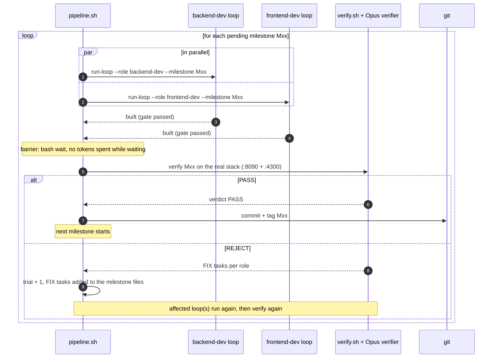
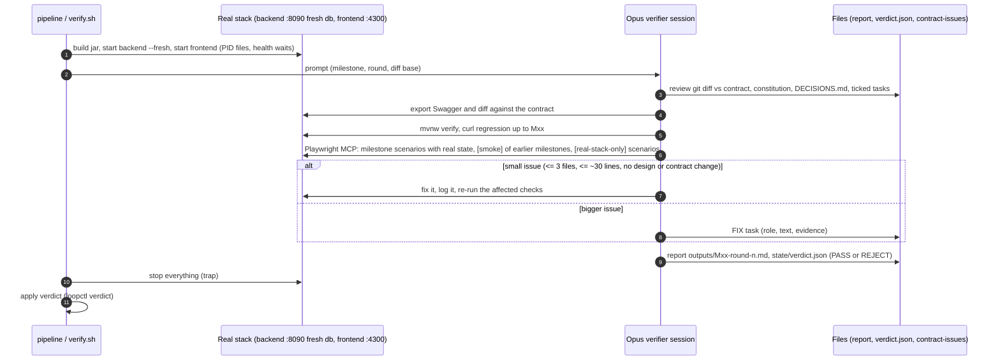
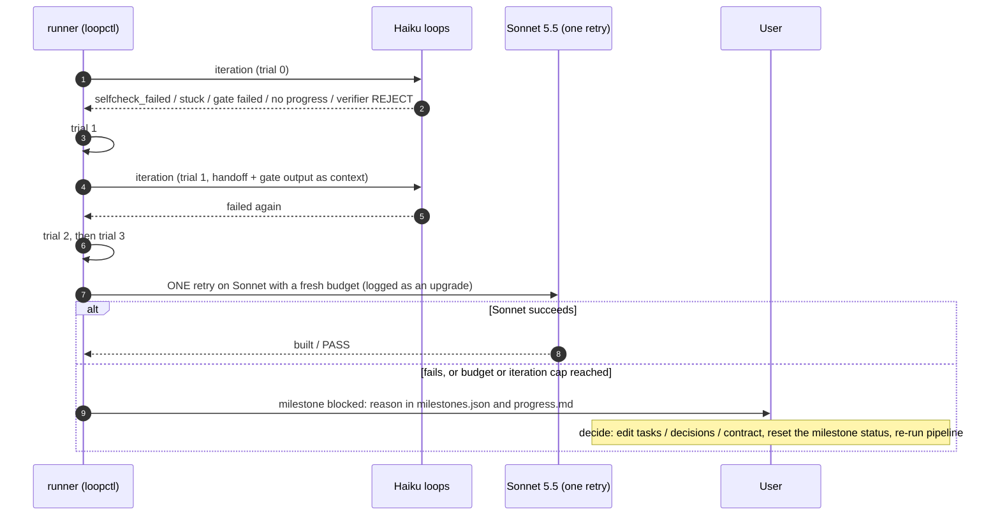
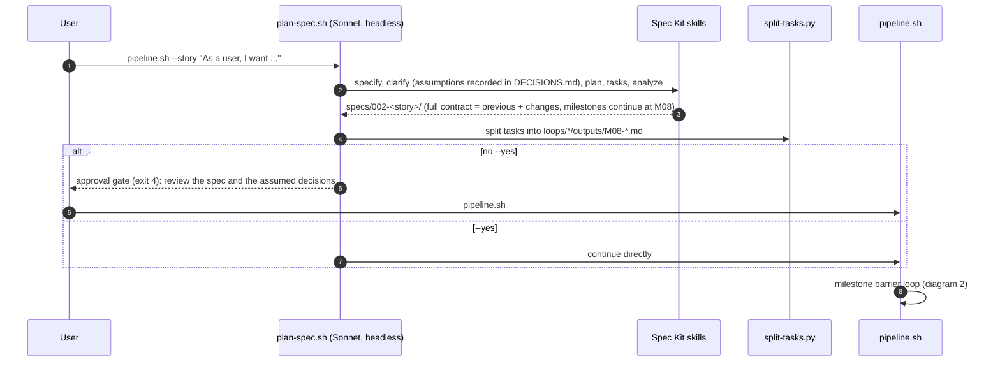

# QuickFlow, built with reusable Claude loops and Spec Kit

QuickFlow is a personal productivity app: tasks, habits, learning resources (with milestones and notes), time-boxed plans with live rest time, a dashboard and settings. The product requirements are in [`requirements/PRD.md`](requirements/PRD.md); the assignment is [`requirements/task-brief.txt`](requirements/task-brief.txt).

It was built by three reusable headless Claude loops that a bash runner coordinates. Planning was done interactively with Spec Kit.

| Loop | Model | Job | Self-check and evidence |
|---|---|---|---|
| `backend-dev` | Haiku 5.5 | Spring Boot 3.5 backend (Java 17, Flyway, H2 file), built to `contracts/openapi.yaml` | `mvnw verify` (JUnit), curl suite per milestone, exported Swagger + diff against the contract |
| `frontend-dev` | Haiku 5.5 | Angular 19 + Material frontend, built to the same contract | `ng build`, Playwright MCP scenarios against a Prism mock of the contract |
| `verify` | Opus 5.5 | Checks a milestone on the real full stack, fixes small issues itself, otherwise rejects with FIX tasks | code review, Swagger diff, JUnit, curl regression, Playwright MCP (milestone + `[smoke]` + `[real-stack-only]` scenarios) |

Stop condition per milestone: complete and verified, or 3 failed trials, then one retry on Sonnet 5.5, then blocked for the user. The loops were used twice: once for the whole PRD (spec 001, M01-M07) and once for a frontend enhancement (spec 002, M08-M11, see below), which shows the reuse.

## How the work was organised

1. **Planning (interactive, Sonnet 5.5, Spec Kit)**: constitution, one spec for the whole PRD, clarification questions answered by the user (`requirements/DECISIONS.md`), plan + data model + the designed Swagger `specs/001-quickflow/contracts/openapi.yaml`, 100 tasks grouped into 7 milestones (each with `[BE]` and `[FE]` tasks), `acceptance.md` (curl cases and Playwright scenarios linked to stories), `speckit-analyze`, then `scripts/split-tasks.py` writes the per-loop milestone files, then the user approved.
2. **Building (`scripts/pipeline.sh`)**: for each milestone the backend and frontend loops run **in parallel**; when both are built and the runner's own gate agrees, the verifier checks it on the real stack; on PASS the runner commits and tags it (`M01` ... `M07`), then the next milestone starts. Contract-first is what makes the parallel run possible: the FE builds against a Prism mock of the contract, the BE builds to the contract, the verifier runs the real stack.
3. **Wrap-up**: this README, `run-artifacts/QuickFlow-prompts-sessions.xlsx` (all prompts and session ids), `run-artifacts/summary.md` (metrics).

## Results of the run

| Milestone | Trials | Verify rounds | BE / FE iterations | Cost USD | Tag |
|---|---|---|---|---|---|
| M01 Foundation | 0 | 1 | 2 / 1 | 2.61 | M01 |
| M02 Tasks | 0 | 1 | 1 / 2 | 3.69 | M02 |
| M03 Habits | 1 (frontend claimed built, the runner gate failed) | 1 | 1 / 5 | 2.91 | M03 |
| M04 Learning | 0 | 1 | 2 / 2 | 2.91 | M04 |
| M05 Plans | 0 | 1 | 3 / 4 | 4.06 | M05 |
| M06 Dashboard | 0 | 1 | 2 / 2 | 2.91 | M06 |
| M07 Hardening | 0 | 1 | 1 / 2 | 4.78 | M07 |

Spec 002 (visual polish, frontend only; M08-M11 continue the numbering):

| Milestone | Trials | Verify rounds | BE / FE iterations | Cost USD | Tag |
|---|---|---|---|---|---|
| M08 Design foundation | 0 | 1 | 0 / 2 | 3.27 | M08 |
| M09 Shell and navigation | 0 | 1 | 0 / 2 | 4.48 | M09 |
| M10 Pages | 0 | 1 | 0 / 4 | 6.03 | M10 |
| M11 Polish and regression | blocked once (3 trials + the Sonnet retry), then unblocked by two user decisions (D-25, D-26) and reset | 1 | 0 / 11 | 8.51 | M11 |

**Totals: 56 headless sessions, $46.17** (Haiku 5.5: 44 sessions, $10.93; Opus 5.5 verifier: 11 sessions, $34.98; Sonnet 5.5 retry: 1 session, $0.27). The verifier is about three quarters of the cost. Full per-session data (ids, models, tokens, cost) is in `run-artifacts/sessions.csv` and the Excel file; per-milestone start/end times, tokens, cost and session ids are in each loop's `progress.md`.

## Enhancement run: spec 002 visual polish
A new spec, planned interactively with Spec Kit like spec 001 and run with the same loops and scripts:
- **Scope**: restyle the Angular app (calm modern look, light/dark/system theme, self-hosted Inter, SVG icons, shared building blocks, responsive shell) with no backend, contract or `data-testid` change. The backend loop found 0 tasks in every milestone and finished at once.
- **Spec folder**: `specs/002-visual-polish/` (spec, plan, research, data model, 38 tasks, acceptance). Its contract is spec 001's, resolved through `contracts/contract-source.txt` (`loopctl.py get-contract`).
- **Decisions**: `requirements/DECISIONS.md` D-19 to D-26. D-25 and D-26 were taken by the user when M11 blocked: the raw bundle warning budget was raised to 650 kB (transfer size 150 kB against a 500 kB goal), and four old scenarios that a stateless mock cannot pass were ignored in the M11 regression.
- **Design system**: tokens, theme handling and the colour rule are described in [`frontend/README.md`](frontend/README.md#design-system).

## Quick start
```bash
(cd tools && npm ci && PLAYWRIGHT_BROWSERS_PATH=$PWD/.browsers node node_modules/playwright/cli.js install chromium)
scripts/pipeline.sh                      # run every pending milestone: BE || FE -> verify -> commit + tag
python3 scripts/loopctl.py status        # where are we?
python3 scripts/loopctl.py excel         # prompts + session ids workbook
```
Requirements on the machine: Java 17, Node 18.20, Maven (only to create the wrapper), `claude` CLI, `specify` CLI (planning only). Never `git push` from the scripts.

## Running the application
Start the stable backend (port 8090) and the frontend dev server (port 4300) by hand. Run each command from the project root.
```bash
scripts/backend.sh start --port 8090 --db stable     # Spring Boot API on http://localhost:8090 (Swagger UI: /swagger-ui.html)
scripts/frontend.sh start --api http://localhost:8090 # Angular on http://localhost:4300, proxies /api to the backend
# open http://localhost:4300
scripts/frontend.sh stop
scripts/backend.sh stop --port 8090
```
- Data: the H2 file database is `backend/data/stable.mv.db` (one file per `--db` name). `--fresh` on `backend.sh start` deletes it first.
- Pages (navigation order): Dashboard, Tasks, Habits, Learning, Plans, Settings. `/` opens the start page chosen in Settings.
- Demo clock: add `?clockOffsetMs=<ms>` to any URL to move the app clock, for example `http://localhost:4300/plans?clockOffsetMs=3600000`. Only the app clock moves, not the server clock.

## Using the loops on their own (reusable)
The loops are not tied to QuickFlow: they take requirements, a story or a story reference and work on whatever spec folder is active.
```bash
scripts/run-loop.sh --role backend-dev  --milestone M03          # one loop, until its part is built (no verification)
scripts/run-loop.sh --role frontend-dev --ref US-TSK-02          # only the tasks tagged with one story, in every milestone that has some
scripts/run-loop.sh --role verify       --milestone M03          # one verification round
scripts/pipeline.sh --story "As a user, I want tags on tasks"    # plans specs/002-<story>/, milestones continue at M08, stops for approval
scripts/pipeline.sh --input path/to/other-PRD.md --yes           # a whole new requirements file, no approval stop
scripts/pipeline.sh --from M03 | --only M03                      # resume or run a single milestone
```
For `--story` / `--input` the planner (`scripts/plan-spec.sh`, Sonnet, headless) cannot ask questions, so ambiguities are recorded as "assumed" decisions in `requirements/DECISIONS.md`, and the run stops at an approval gate unless `--yes` is given. Each new spec's `contracts/openapi.yaml` is the full API (previous contract plus changes).

## Layout
```
requirements/   PRD.md, task-brief.txt, DECISIONS.md (user answers, override the PRD)
specs/001-quickflow/   spec, plan, research, data-model, quickstart, tasks, acceptance, contracts/openapi.yaml
.specify/ .claude/skills/speckit-*   Spec Kit (constitution in .specify/memory/constitution.md)
loops/_shared/   PROTOCOL.md, budget.env, milestones.json (runner state), assumptions.md, contract-issues.md
loops/<role>/    Loop-instructions.md, task.md, progress.md, state/, outputs/ (Mxx-*.md with ticked tasks, curl/, e2e/, evidence/)
scripts/         run-loop.sh, pipeline.sh, verify.sh, plan-spec.sh, backend.sh, frontend.sh, mock.sh, curl-*.sh, export-swagger.sh, loopctl.py, split-tasks.py
backend/ frontend/   the application        tools/   pinned Playwright MCP 0.0.40, Prism 5.12.0, local Chromium
run-artifacts/   sessions.csv, manual-prompts.csv, prompts/, logs/, playwright/, summary.md, QuickFlow-prompts-sessions.xlsx
```
Each loop folder has the files the assignment asks for: `Loop-instructions.md`, `task.md`, `progress.md` (runner-generated table with start/end time, tokens, cost and session ids per milestone plus the agent's action log), `state/` and `outputs/` (one markdown file per milestone with the ticked tasks).

Ports: **8091** backend self-check, **8090** stable backend (verifier), **4300** frontend dev server, **4010** Prism mock.

## How a loop works internally

The bash runner owns control flow, trials, budget, servers, git and metrics. Claude only does the work of one iteration and writes files. All memory is in files.

### 1. One iteration of a dev loop

```mermaid
sequenceDiagram
    autonumber
    participant R as run-loop.sh (runner)
    participant L as loopctl.py (state)
    participant C as claude -p (Haiku, fresh session)
    participant F as Files (task.md, milestone md, handoff, result.json)
    participant G as Gate (mvnw+curl+swagger or ng build+e2e result)

    R->>L: preflight (budget, iteration cap, trial)
    L-->>R: run <iteration> <model> <budget left>
    L->>F: write task.md
    R->>C: fixed short prompt (role, milestone, iteration)
    C->>F: read PROTOCOL, Loop-instructions, task.md, handoff.md, milestone file
    C->>C: implement up to ~5 tasks (FIX tasks first)
    C->>C: self-check: backend = mvnw verify + curl + Swagger export; frontend = ng build + Playwright MCP on the Prism mock
    C->>F: tick tasks, action log, handoff.md, state/result.json
    C-->>R: JSON (session id, model, tokens, cost)
    R->>L: record (sessions.csv, progress.md)
    alt result = built
        R->>G: re-check deterministically (the claim is not trusted)
        G-->>R: pass / fail
    end
    R->>L: decide
    L-->>R: continue | built | upgrade | blocked
```

### 2. Milestone barrier (pipeline)



### 3. One verifier round



### 4. Trials, the Sonnet upgrade and blocked



### 5. A new story with the same loops



## Guards
- No tokens are spent while waiting (`bash wait`); servers start and stop only through the PID-file scripts, with `trap` cleanup.
- Per-milestone budget ceilings (`loops/_shared/budget.env`) plus a hard `--max-budget-usd` per session, an iteration cap, a session timeout and a suspend watchdog.
- Dev loops never commit, tag, push, or edit the contract (their permission files deny it); contract problems go to `loops/_shared/contract-issues.md`, assumptions to `loops/_shared/assumptions.md`.
- The runner re-checks every "built" claim with its own gate before trusting it.

## Blocked milestones
`python3 scripts/loopctl.py status` shows the reason. After resolving it (budget, contract, decision), set the milestone's `status` in `loops/_shared/milestones.json` back to `building` (and `trial`/`upgraded` if you want new trials), then re-run `scripts/pipeline.sh`. It resumes where it stopped.
